<p align="center">
  <picture>
    <source media="(prefers-color-scheme: dark)" srcset="assets/banner-dark.svg">
    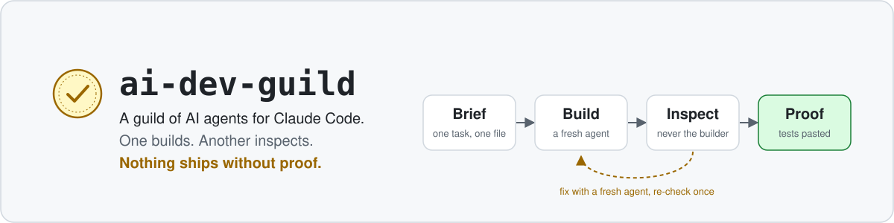
  </picture>
</p>

<p align="center">
  <a href="LICENSE"></a>
  
  
  
</p>

<p align="center">
  <a href="#what-the-loop-catches">What it catches</a> ·
  <a href="#who-does-what">Who does what</a> ·
  <a href="#how-it-works">How it works</a> ·
  <a href="#living-pages">Living pages</a> ·
  <a href="#install-in-2-minutes">Install</a> ·
  <a href="#whats-inside">What's inside</a> ·
  <a href="docs/mistakes.md">Mistakes it prevents</a>
</p>

---

### One agent builds. Another inspects. Nothing ships without proof.

A Claude Code plugin. AI agents say "done" before any test has run. Here, a **different** agent
checks the work, and **done means the test output is pasted in.**

## What the loop catches

<picture>
  <source media="(max-width: 700px) and (prefers-color-scheme: dark)" srcset="assets/stats-tall-dark.svg">
  <source media="(max-width: 700px)" srcset="assets/stats-tall-light.svg">
  <source media="(prefers-color-scheme: dark)" srcset="assets/stats-wide-dark.svg">
  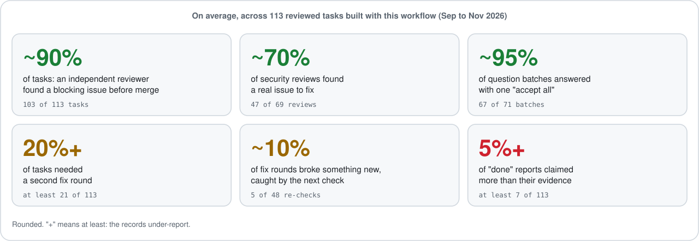
</picture>

<sub>Counted from the review and fix records of real work. Check your own sessions with
[`token-review`](plugin/skills/token-review/SKILL.md).</sub>

## What changes

| Without                             | With the guild                               |
| ----------------------------------- | -------------------------------------------- |
| "All tests pass." No test ran.      | ✅ Done = pasted test output                 |
| The agent reviews its own code.     | 🔍 A different agent reviews                 |
| Questions drip in during the build. | 📋 One batch of questions first              |
| Fix rounds drag on for days.        | 🔁 Fresh fixer, one re-check                 |
| "While I was there, I tidied up…"   | ✂️ Only the task changes                     |
| `pkill` kills every agent's tests.  | 🛡️ Guard hooks refuse it                     |
| Progress scrolls away in the chat.  | 📊 Pages kept current, open on a phone       |
| "Robust, comprehensive fix."        | 📝 Plain words, each claim with its evidence |

## How it works

<picture>
  <source media="(max-width: 700px) and (prefers-color-scheme: dark)" srcset="assets/loop-tall-dark.svg">
  <source media="(max-width: 700px)" srcset="assets/loop-tall-light.svg">
  <source media="(prefers-color-scheme: dark)" srcset="assets/loop-wide-dark.svg">
  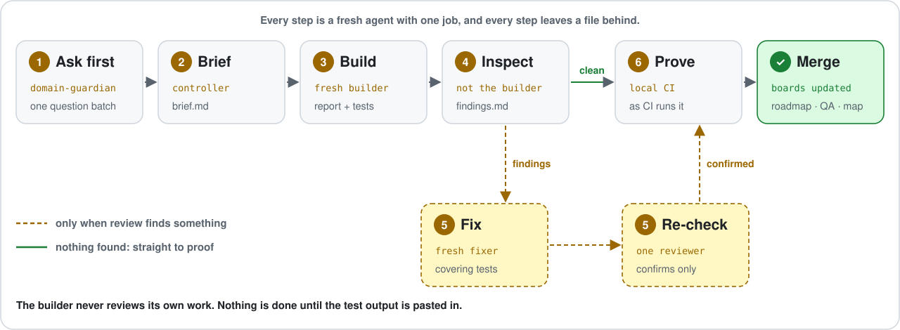
</picture>

**Ask → brief → build → inspect → fix → prove → merge.** Big trade-offs go to the
**board**: eight advisor agents, and you decide. Details: [docs/loop.md](docs/loop.md).

## Who does what

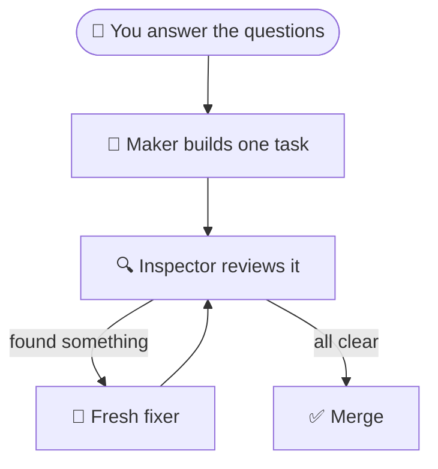

- **🔨 Makers:** builder, fixer, db-migrations.
- **🔍 Inspectors:** architect, security, domain, QA, design, UX, docs. None of them built it.
- **🏛️ Board:** eight advisors for hard trade-offs. You decide.

## Living pages

<picture>
  <source media="(max-width: 700px) and (prefers-color-scheme: dark)" srcset="assets/pages-tall-dark.svg">
  <source media="(max-width: 700px)" srcset="assets/pages-tall-light.svg">
  <source media="(prefers-color-scheme: dark)" srcset="assets/pages-wide-dark.svg">
  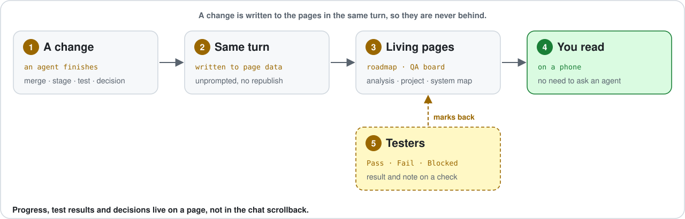
</picture>

<table>
<tr><td colspan="2"><picture><source media="(prefers-color-scheme: dark)" srcset="assets/screens/roadmap-dark.png">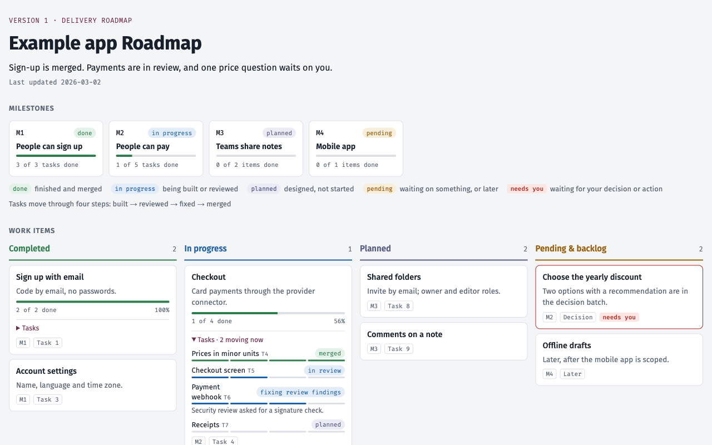</picture><br><sub><b>Roadmap</b>: milestones, a four-lane board, and what waits on you.</sub></td></tr>
<tr><td width="50%"><picture><source media="(prefers-color-scheme: dark)" srcset="assets/screens/qa-dark.png">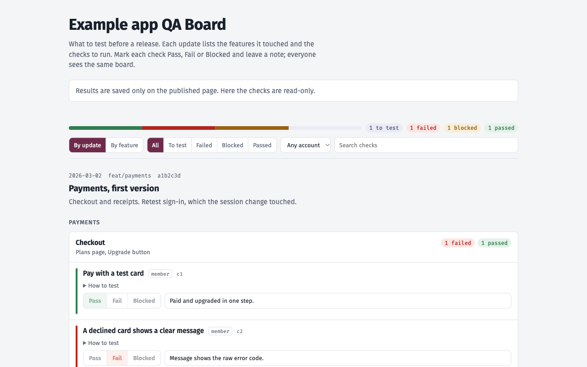</picture><br><sub><b>QA board</b>: each change's checks, marked by testers.</sub></td>
<td width="50%"><picture><source media="(prefers-color-scheme: dark)" srcset="assets/screens/analysis-dark.png">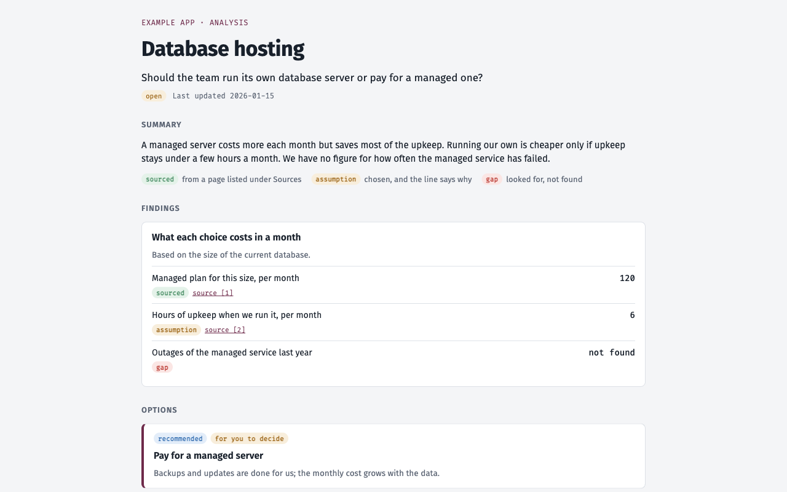</picture><br><sub><b>Analysis page</b>: every figure tagged, you decide.</sub></td></tr>
<tr><td width="50%"><picture><source media="(prefers-color-scheme: dark)" srcset="assets/screens/system-map-dark.png">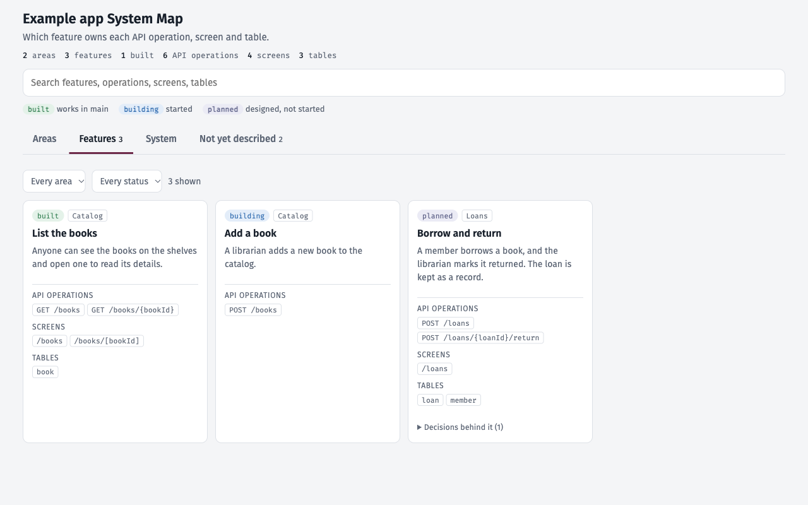</picture><br><sub><b>System map</b>: which feature owns each operation, screen and table.</sub></td>
<td width="50%"><picture><source media="(prefers-color-scheme: dark)" srcset="assets/screens/map-dark.png">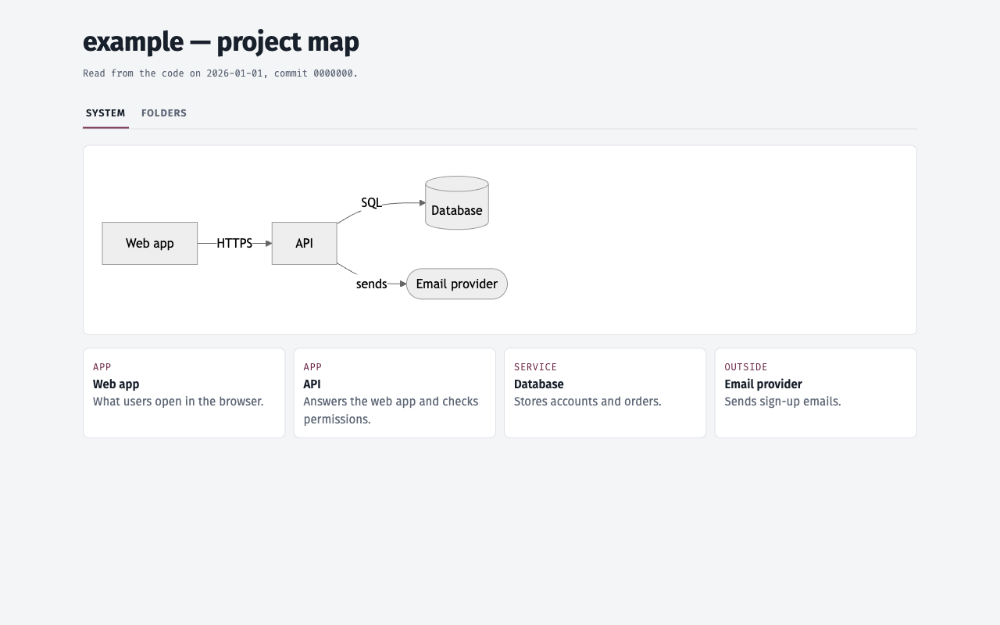</picture><br><sub><b>Project map</b>: the parts and who talks to whom.</sub></td></tr>
</table>

Roadmap · QA board · analysis page · flow stats · project map · system map.
How they stay current: [docs/living-pages.md](docs/living-pages.md).

## Plain reports

<picture>
  <source media="(max-width: 700px) and (prefers-color-scheme: dark)" srcset="assets/plain-report-tall-dark.svg">
  <source media="(max-width: 700px)" srcset="assets/plain-report-tall-light.svg">
  <source media="(prefers-color-scheme: dark)" srcset="assets/plain-report-wide-dark.svg">
  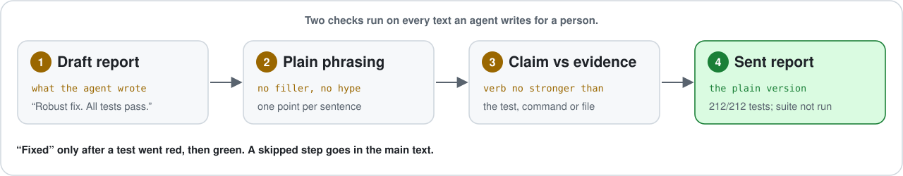
</picture>

| Before                                     | After                                                                                      |
| ------------------------------------------ | ------------------------------------------------------------------------------------------ |
| Robust, comprehensive fix. All tests pass. | Fixed February 29 parsing. New test failed, now passes. Unit 212/212; integration not run. |

<sub>Skill: [`plain-report`](plugin/skills/plain-report/SKILL.md). Ideas from
[academic-humanizer](https://github.com/AIScientists-Dev/academic-humanizer) and
[humanizer](https://github.com/blader/humanizer) (both MIT); no text copied.</sub>

## Install in 2 minutes

```
/plugin marketplace add mgionas/ai-dev-guild
/plugin install ai-dev-guild@ai-dev-guild
```

Start a new session, then:

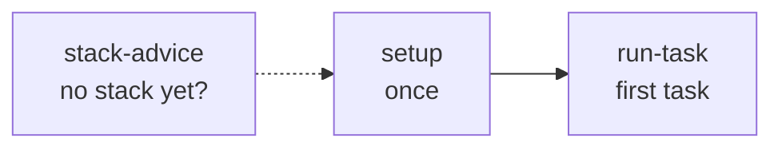

```
/ai-dev-guild:setup
/ai-dev-guild:run-task <a task from your plan>
```

Optional guard hooks (Node.js 22.5+): `/plugin install ai-dev-guild-guards@ai-dev-guild`

<sub>[Copy files instead](docs/install.md) · [upgrade and remove](docs/upgrade-and-remove.md) · [troubleshooting](docs/troubleshooting.md)</sub>

## What's inside

### ⚙️ Skills

`stack-advice` · `roadmap` · `analysis-page` · `flow-stats` · `project-map` · `token-review` · `run-task` · `write-brief` · `review-panel` · `fix-round` · `decision-batch` · `board` ·
`design-review` · `research-review` · `plain-report` · `local-ci` · `local-environment` · `system-map` · `progress-boards` · `setup`

### 📚 In detail

<details>
<summary><b>Every role, with what it gets and what it returns</b></summary>

| Makers                                       | Inspectors                                           | Board                                                            |
| -------------------------------------------- | ---------------------------------------------------- | ---------------------------------------------------------------- |
| [builder](docs/roles/builder.md)             | [architect](docs/roles/architect.md)                 | [product-manager](docs/roles/board-product-manager.md)           |
| [fixer](docs/roles/fixer.md)                 | [security-reviewer](docs/roles/security-reviewer.md) | [tech-lead](docs/roles/board-tech-lead.md)                       |
| [db-migrations](docs/roles/db-migrations.md) | [domain-guardian](docs/roles/domain-guardian.md)     | [finance-expert](docs/roles/board-finance-expert.md)             |
|                                              | [qa-tester](docs/roles/qa-tester.md)                 | [legal-advisor](docs/roles/board-legal-advisor.md)               |
|                                              | [designer](docs/roles/designer.md)                   | [user-advocate](docs/roles/board-user-advocate.md)               |
|                                              | [ux-researcher](docs/roles/ux-researcher.md)         | [operations-expert](docs/roles/board-operations-expert.md)       |
|                                              | [docs-keeper](docs/roles/docs-keeper.md)             | [business-development](docs/roles/board-business-development.md) |
|                                              |                                                      | [domain-expert](docs/roles/board-domain-expert.md)               |

Outside the board: [stack-advisor](docs/roles/stack-advisor.md) for choosing tools and services, and
[token-optimizer](docs/roles/token-optimizer.md) for spending fewer tokens, and
[status-keeper](docs/roles/status-keeper.md) for keeping the roadmap true to git.

Each role has a default model: opus where judgement is the whole job (security, architecture,
high-stakes logic, the stack advisor, the board's chair, finance and legal seats, design), sonnet for the rest.
</details>

<details>
<summary><b>Every skill</b></summary>

| Skill                                                | Use it to                                                 |
| ---------------------------------------------------- | --------------------------------------------------------- |
| [`setup`](plugin/skills/setup/SKILL.md)                     | prepare a project for the loop, once                      |
| [`stack-advice`](plugin/skills/stack-advice/SKILL.md) | get a sourced stack and testing proposal for a new project |
| [`roadmap`](plugin/skills/roadmap/SKILL.md) | build a roadmap of milestones and steps from a plan or an idea |
| [`analysis-page`](plugin/skills/analysis-page/SKILL.md) | publish the facts behind a decision, each figure tagged, and record the answer |
| [`flow-stats`](plugin/skills/flow-stats/SKILL.md) | count how the workflow is going, and suggest what to change |
| [`project-map`](plugin/skills/project-map/SKILL.md) | draw a page of the system and its folders, read from the code |
| [`token-review`](plugin/skills/token-review/SKILL.md) | find where sessions spent tokens and how to spend fewer |
| [`run-task`](plugin/skills/run-task/SKILL.md)               | run one task through the whole loop                       |
| [`write-brief`](plugin/skills/write-brief/SKILL.md)         | write a brief a fresh agent can work from alone           |
| [`review-panel`](plugin/skills/review-panel/SKILL.md)       | choose reviewers by what the change touches               |
| [`fix-round`](plugin/skills/fix-round/SKILL.md)             | fix findings with a fresh agent, then confirm once        |
| [`decision-batch`](plugin/skills/decision-batch/SKILL.md)   | ask every open question at once, with recommendations     |
| [`board`](plugin/skills/board/SKILL.md)                     | put a decision with real trade-offs to the board          |
| [`design-review`](plugin/skills/design-review/SKILL.md)     | review a built screen from screenshots first              |
| [`research-review`](plugin/skills/research-review/SKILL.md) | check a flow against personas, heuristics and WCAG 2.2 AA |
| [`local-ci`](plugin/skills/local-ci/SKILL.md)               | run, or set up, a local check as strict as CI             |
| [`local-environment`](plugin/skills/local-environment/SKILL.md) | advise a local setup: own containers, local HTTPS, a ports registry, telemetry, fake providers, a dev-only security policy |
| [`plain-report`](plugin/skills/plain-report/SKILL.md) | clean up prose for a human reader; no claim beyond its evidence |
| [`system-map`](plugin/skills/system-map/SKILL.md)           | keep a map of features, screens and tables current        |
| [`progress-boards`](plugin/skills/progress-boards/SKILL.md) | keep the roadmap and QA board current with every change   |

Stack-specific starting points (database migrations, API endpoints, events, screens, a CI runner)
are in [examples](examples/README.md), clearly marked and not loaded by the plugin.
</details>

<details>
<summary><b>The guard hooks in detail</b> (the optional <code>ai-dev-guild-guards</code> plugin)</summary>

| Hook          | Refuses (or asks)                                                                                                                               |
| ------------- | ----------------------------------------------------------------------------------------------------------------------------------------------- |
| `guard-paths` | an edit to a file in `.claude/protected-paths` (default: `.env` files, not `.env.example`), symlinks included; asks before a hook file          |
| `bash-guard`  | `pkill`, `killall`, `kill $(pgrep …)`; `--no-verify` (abbreviated too), `git commit -n`, `core.hooksPath`, `HUSKY=0`; a protected-file write    |
|               | any command naming a secret file, except the few that do not read it (`ls`, `rm`, `touch`, `chmod`, `stat`, `test`, `echo`, `source .env`, …)   |
|               | `core.hooksPath` set by `git config`, `--config-env`, `GIT_CONFIG_KEY_<n>` or `GIT_CONFIG_PARAMETERS` (unsetting or reading it is fine)         |
|               | `node -e`, `python3 -c`, `ruby -e`, `perl -e`, `php -r`, `bun -e`, `deno eval`, or a heredoc fed to an interpreter, naming a secret file       |
|               | `node --env-file=.env -p …` when the code mentions `env` (the code prints what the file loads); asks when it does not                           |
|               | asks: any `kill` but `kill %1`, `kill $!` or `kill -0` (`kill 1234`, `kill $PID`, `kill $(lsof …)`), since it cannot tell whose process that is |
|               | asks: a shell that reads its script from a pipe (`curl … \| bash`) or another input it cannot see                                               |
|               | asks: a shell whose `-c` string or here-string is built from an expansion (`bash -c "$(curl …)"`, `bash -c "$CMD"`)                             |
|               | asks: `source` or `.` of a script it cannot see (`source <(curl …)`, `. /dev/stdin`, `source /dev/fd/3`, zsh `=(…)`)                            |
|               | asks: a shell run on an unquoted heredoc whose body expands something (`bash <<EOF` with `$name` or `$(…)` inside)                              |
|               | asks: deleting, moving, writing or re-moding a git hook, hook manager file or `.git/config` (`rm .git/hooks/…`, `chmod -x .husky/…`, `lefthook.yml`) |
|               | asks: `lefthook uninstall`, `pre-commit uninstall`, and `perl -pi` or `ruby -pi` on a hook file, as for `sed -i`                                |
|               | asks: `git commit` or `git push` with pre-commit's `SKIP=` set; a variable set to a secret file name and then expanded, also by a nested shell (`F=.env; cat $F`, `F=.env bash -c 'cat $F'`) |
| `guard-reads` | the Read and Grep tools opening a secret file (`.env`, `.env.*` in any folder; not `.env.example`, `.env.sample`, `.env.template`)              |
| `after-edit`  | nothing by itself: it runs your executable `.claude/after-edit` on each edited file and sends any failure back to Claude                        |

They ignore text inside quotes, heredocs and comments, so `grep pkill` or a commit message is fine
(a `$(…)` inside double quotes and a heredoc a shell runs are still read). They fail
open on bad input: your pre-commit hooks and CI stay the authority. With the default rules,
`cp .env.example .env` and `mv .env .env.bak` are refused too, since each writes a protected file,
so create and rename secret files yourself. The hooks do not protect their own files or
`.claude/protected-paths`.
</details>

## Who it's for

- 👩‍💻 Developers using Claude Code on real projects
- 🌱 People with an idea but no stack yet
- 🤖 Teams running several agents at once
- 🧑‍💼 Product owners who decide but don't code

Not for one-off scripts.

## The ideas behind it

[Working rules](docs/rules/README.md) and [mistakes that keep happening](docs/mistakes.md). The core six:

1. [The builder never reviews its own work.](docs/rules/builder-never-reviews.md)
2. [One task per fresh agent.](docs/rules/one-task-fresh-agent.md)
3. [Evidence before done.](docs/rules/evidence-before-done.md)
4. [Change only what the task needs.](docs/rules/change-only-the-task.md)
5. [Write down what you assumed.](docs/rules/write-down-assumptions.md)
6. [Build nothing nobody asked for.](docs/rules/build-nothing-unasked.md)

It reads your `AGENTS.md` and glossary and asks instead of inventing.

## Contributing

One change per pull request, with its reason: [CONTRIBUTING.md](CONTRIBUTING.md) · [CHANGELOG](CHANGELOG.md)

## Licence

[MIT](LICENSE)
