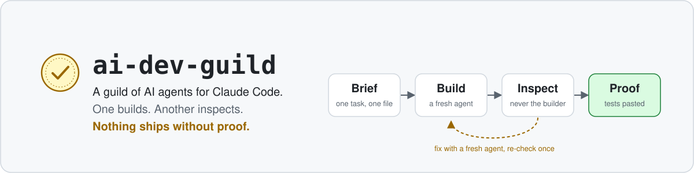
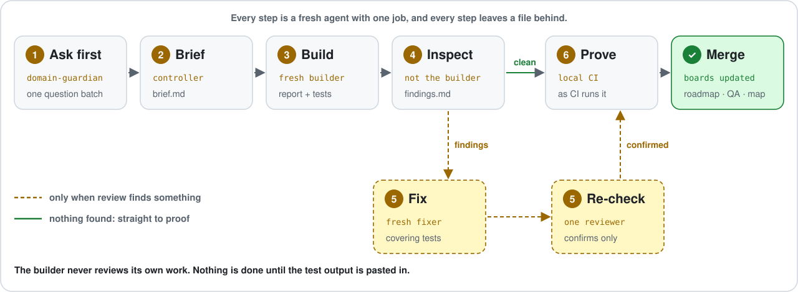

<p align="center">
  <picture>
    <source media="(prefers-color-scheme: dark)" srcset="assets/banner-dark.svg">
    
  </picture>
</p>

<p align="center">
  <a href="LICENSE"></a>
  
  
  
</p>

<p align="center">
  <a href="#install-in-2-minutes">Install</a> ·
  <a href="#how-it-works">How it works</a> ·
  <a href="#what-changes">What changes</a> ·
  <a href="#whats-inside">What's inside</a> ·
  <a href="docs/mistakes.md">Mistakes it prevents</a>
</p>

---

### One agent builds. Another inspects. Nothing ships without proof.

AI agents write code fast and report success with confidence, even when no test has run. In a
craft guild, no maker stamps their own work: a master inspects it first. **ai-dev-guild is a
Claude Code plugin that brings that rule to your project.** Each task goes to a fresh builder
agent. A different agent reviews it, and the task is not done until the test output is pasted in.

## What changes

| Without the guild                                           | With the guild                                                                                                                     |
| ----------------------------------------------------------- | ---------------------------------------------------------------------------------------------------------------------------------- |
| "Done! All tests pass." No test ever ran.                   | **Done means pasted output** of the tests, type check and lint. No output, no done.                                                |
| The agent reviews its own code and agrees with itself.      | **A different agent reviews**, and never sees the builder's reasoning, so it catches the misunderstanding instead of repeating it. |
| Questions turn up halfway through the build, one at a time. | **One batch of questions before the build**, each with a recommendation. You answer "accept all" in a minute.                      |
| Fix rounds reopen the review and run for days.              | **A fresh fixer, then one re-check that only confirms.** After two rounds, you decide whether to go on.                            |
| "While I was there, I tidied up…"                           | **Only the task changes.** Anything else noticed goes on a list, with `file:line`.                                                 |
| `pkill -f jest` kills every agent's test run.               | **A guard hook refuses pattern kills**, skipped git hooks and edits to protected files.                                            |
| `price * 100` and the server's time zone, baked in.         | **No country assumed:** currency codes, UTC with real time zones, locale formats.                                                  |

## How it works

<picture>
  <source media="(max-width: 700px) and (prefers-color-scheme: dark)" srcset="assets/loop-tall-dark.svg">
  <source media="(max-width: 700px)" srcset="assets/loop-tall-light.svg">
  <source media="(prefers-color-scheme: dark)" srcset="assets/loop-wide-dark.svg">
  
</picture>

1. **Ask first.** Before anything is built, the product questions go to you in one batch, each
   with a recommended answer.
2. **Brief.** The task is written down for a fresh agent: goal, scope, tests to run, your answers.
3. **Build.** A new agent writes the failing test first, builds, and pastes what it ran.
4. **Inspect.** Reviewers are chosen by what changed (security, money, schema, screens). None of
   them built it.
5. **Fix and confirm.** A fresh fixer handles the findings; one re-check confirms them.
6. **Prove it.** The checks run once, the way CI runs them, on everything the change can reach, and
   then the work merges.

Bigger choices (scope, pricing, legal exposure) go to the **board**: eight advisor agents who
answer independently, a summary that keeps disagreement visible, and you making the call.
More on the loop: [docs/loop.md](docs/loop.md).

## Install in 2 minutes

> Plugins load when a session starts. After installing (or after copying files), start a new
> session.

In Claude Code:

```
/plugin marketplace add mgionas/ai-dev-guild
/plugin install ai-dev-guild@ai-dev-guild
```

Set up your project once. This writes an `AGENTS.md` with the working rules and the permission
rules in `.claude/settings.json`, and asks before it touches any existing file:

```
/ai-dev-guild:setup
```

New to building, with no stack chosen yet? Describe your idea and get a sourced proposal for
hosting, database and testing:

```
/ai-dev-guild:stack-advice <what you want to build>
```

Then hand it your first task:

```
/ai-dev-guild:run-task <a task from your plan>
```

Optional guard hooks (needs Node.js 22.5 or later):

```
/plugin install ai-dev-guild-guards@ai-dev-guild
```

<sub>Prefer plain files to a plugin? [Copy the folders instead](docs/install.md).</sub>

## What's inside

### 🔨 Makers

**builder** builds one task from a brief · **fixer** fixes findings in a fresh context ·
**money-specialist** handles prices and payments in integer minor units · **db-migrations**
writes backward-compatible schema changes · **i18n** keeps every language file complete.

### 🔍 Inspectors

**architect** checks structure and contracts · **security-reviewer** checks access, secrets and
personal data · **domain-guardian** checks your words and business rules · **qa-tester** tries to
break it · **designer** reviews screenshots of each screen · **ux-researcher** checks flows
against real users · **docs-keeper** keeps the docs true.

### 🧭 Stack advisor

Describe your project and get a stack proposal: hosting, database, auth, email, payments and
monitoring, each with an alternative, today's free tier (linked and dated), the regions it serves
and how to leave it. It also sets up how you test: a preview per change, database branches and
staging. You decide and sign up yourself.

### 🗺️ See where you are

**Roadmap:** milestones a user can see, each step with its stage (planned, building, review,
fixing, merged), and what waits on you; it and the QA board ship as ready-made pages that work
with the artifact database or with rows embedded in a plain file. **Project map:** one page with a
diagram of the parts and who talks to whom, plus every folder and its job, read from the code.
**Token review:** where your sessions spent their tokens, and a few rules to spend less.

### 🏛️ The board

Eight advisors for decisions with real trade-offs: product (chair), tech, finance, legal, users,
operations, growth and your industry. They never see each other's answers.

### ⚙️ Skills

`stack-advice` · `roadmap` · `project-map` · `token-review` · `run-task` · `write-brief` · `review-panel` · `fix-round` · `decision-batch` · `board` ·
`design-review` · `research-review` · `local-ci` · `local-environment` · `system-map` · `progress-boards` · `setup`

### 🛡️ Guard hooks (optional)

A separate plugin, `ai-dev-guild-guards`, in the same marketplace. It refuses edits to protected
files (`.env` by default), `pkill`/`killall`, `--no-verify` and other skipped git hooks, and reading
or sending `.env` files from the shell or the Read and Grep tools. It asks you before any `kill`
of a process that is not the agent's own job, since it cannot tell whose process that is, and can
run your own formatter after every edit. The main plugin has no hooks or scripts at all.

<details>
<summary><b>Every role, with what it gets and what it returns</b></summary>

| Makers                                             | Inspectors                                           | Board                                                            |
| -------------------------------------------------- | ---------------------------------------------------- | ---------------------------------------------------------------- |
| [builder](docs/roles/builder.md)                   | [architect](docs/roles/architect.md)                 | [product-manager](docs/roles/board-product-manager.md)           |
| [fixer](docs/roles/fixer.md)                       | [security-reviewer](docs/roles/security-reviewer.md) | [tech-lead](docs/roles/board-tech-lead.md)                       |
| [money-specialist](docs/roles/money-specialist.md) | [domain-guardian](docs/roles/domain-guardian.md)     | [finance-expert](docs/roles/board-finance-expert.md)             |
| [db-migrations](docs/roles/db-migrations.md)       | [qa-tester](docs/roles/qa-tester.md)                 | [legal-advisor](docs/roles/board-legal-advisor.md)               |
| [i18n](docs/roles/i18n.md)                         | [designer](docs/roles/designer.md)                   | [user-advocate](docs/roles/board-user-advocate.md)               |
|                                                    | [ux-researcher](docs/roles/ux-researcher.md)         | [operations-expert](docs/roles/board-operations-expert.md)       |
|                                                    | [docs-keeper](docs/roles/docs-keeper.md)             | [business-development](docs/roles/board-business-development.md) |
| | | [domain-expert](docs/roles/board-domain-expert.md) |

Outside the board: [stack-advisor](docs/roles/stack-advisor.md) for choosing tools and services, and
[token-optimizer](docs/roles/token-optimizer.md) for spending fewer tokens.

Each role has a default model: opus where judgement is the whole job (security, architecture,
money, the stack advisor, the board's chair, finance and legal seats, design), sonnet for the rest.
</details>

<details>
<summary><b>Every skill</b></summary>

| Skill                                                           | Use it to                                                           |
| --------------------------------------------------------------- | ------------------------------------------------------------------- |
| [`setup`](plugin/skills/setup/SKILL.md)                         | prepare a project for the loop, once                                |
| [`stack-advice`](plugin/skills/stack-advice/SKILL.md)           | get a sourced stack and testing proposal for a new project          |
| [`roadmap`](plugin/skills/roadmap/SKILL.md)                     | build a roadmap of milestones and steps from a plan or an idea      |
| [`project-map`](plugin/skills/project-map/SKILL.md)             | draw a page of the system and its folders, read from the code       |
| [`token-review`](plugin/skills/token-review/SKILL.md)           | find where sessions spent tokens and how to spend fewer             |
| [`run-task`](plugin/skills/run-task/SKILL.md)                   | run one task through the whole loop                                 |
| [`write-brief`](plugin/skills/write-brief/SKILL.md)             | write a brief a fresh agent can work from alone                     |
| [`review-panel`](plugin/skills/review-panel/SKILL.md)           | choose reviewers by what the change touches                         |
| [`fix-round`](plugin/skills/fix-round/SKILL.md)                 | fix findings with a fresh agent, then confirm once                  |
| [`decision-batch`](plugin/skills/decision-batch/SKILL.md)       | ask every open question at once, with recommendations               |
| [`board`](plugin/skills/board/SKILL.md)                         | put a decision with real trade-offs to the board                    |
| [`design-review`](plugin/skills/design-review/SKILL.md)         | review a built screen from screenshots first                        |
| [`research-review`](plugin/skills/research-review/SKILL.md)     | check a flow against personas, heuristics and WCAG 2.2 AA           |
| [`local-ci`](plugin/skills/local-ci/SKILL.md)                   | run, or set up, a local check as strict as CI                       |
| [`local-environment`](plugin/skills/local-environment/SKILL.md) | advise a local setup: own containers, local HTTPS, a ports registry |
| [`system-map`](plugin/skills/system-map/SKILL.md)               | keep a map of features, screens and tables current                  |
| [`progress-boards`](plugin/skills/progress-boards/SKILL.md)     | keep the roadmap and QA board current with every change             |

Stack-specific starting points (database migrations, API endpoints, events, screens, a CI runner)
are in [examples](examples/README.md), clearly marked and not loaded by the plugin.
</details>

<details>
<summary><b>The guard hooks in detail</b> (the optional <code>ai-dev-guild-guards</code> plugin)</summary>

| Hook          | Refuses (or asks)                                                                                                                               |
| ------------- | ----------------------------------------------------------------------------------------------------------------------------------------------- |
| `guard-paths` | an edit to a file listed in `.claude/protected-paths` (default: `.env` files, not `.env.example`), symlinks included                            |
| `bash-guard`  | `pkill`, `killall`, `kill $(pgrep …)`; `--no-verify`, `git commit -n`, `core.hooksPath`, `HUSKY=0`; a shell write to a protected file           |
|               | any command naming a secret file, except the few that do not read it (`ls`, `rm`, `touch`, `chmod`, `stat`, `test`, `echo`, `source .env`, …)   |
|               | asks: any `kill` but `kill %1`, `kill $!` or `kill -0` (`kill 1234`, `kill $PID`, `kill $(lsof …)`), since it cannot tell whose process that is |
|               | asks: a shell that reads its script from a pipe (`curl … \| bash`) or another input it cannot see                                               |
|               | asks: a shell whose `-c` string or here-string is built from an expansion (`bash -c "$(curl …)"`, `bash -c "$CMD"`)                             |
| `guard-reads` | the Read and Grep tools opening a secret file (`.env`, `.env.*` in any folder; not `.env.example`, `.env.sample`, `.env.template`)              |
| `after-edit`  | nothing by itself: it runs your executable `.claude/after-edit` on each edited file and sends any failure back to Claude                        |

They ignore text inside quotes, heredocs and comments, so `grep pkill` or a commit message is fine
(a `$(…)` inside double quotes and a heredoc a shell runs are still read). They fail
open on bad input: your pre-commit hooks and CI stay the authority. With the default rules,
`cp .env.example .env` and `mv .env .env.bak` are refused too, since each writes a protected file,
so create and rename secret files yourself. The hooks do not protect their own files or
`.claude/protected-paths`.
</details>

## Who it's for

- **Developers who use Claude Code on real projects** and want its work checked the way a
  colleague's would be.
- **People new to building** who have an idea but no stack: the stack advisor proposes hosting,
  a database and a safe way to test, checked against today's plans and your users' country.
- **Teams running several agents at once**, who need them not to break each other's work.
- **Product owners who decide but don't code**: you get questions in batches with
  recommendations, and your decisions are recorded and never quietly rewritten.

It is not for one-off scripts: the loop pays off when a mistake would cost more than a review.

## It fits your project, not the other way round

- **It learns your project from your files.** Every role reads your `AGENTS.md`, your glossary and
  your commands, whatever language or framework you use. Advice tied to one framework sits in
  [examples](examples/README.md).
- **It assumes nothing local.** Amounts are stored with their currency, times in UTC with the
  user's time zone, and dates and numbers in the user's format. Tax and legal rules come from you.
  See [Assume no country](docs/rules/international-by-default.md).
- **It asks instead of inventing.** It never makes up product terms or makes product, money or
  legal decisions for you.

## The ideas behind it

Twenty-five short [working rules](docs/rules/README.md), each with its reason, and twenty
[mistakes that keep happening](docs/mistakes.md), each with a tiny reproduction. The core six:

1. [The builder never reviews its own work.](docs/rules/builder-never-reviews.md)
2. [One task per fresh agent, with a brief and a report.](docs/rules/one-task-fresh-agent.md)
3. [Evidence before done.](docs/rules/evidence-before-done.md)
4. [Change only what the task needs.](docs/rules/change-only-the-task.md)
5. [Write down what you assumed.](docs/rules/write-down-assumptions.md)
6. [Build nothing nobody asked for.](docs/rules/build-nothing-unasked.md)

## Contributing

One change per pull request, each with its reason. See [CONTRIBUTING.md](CONTRIBUTING.md) and
the [CHANGELOG](CHANGELOG.md).

## Licence

[MIT](LICENSE)
