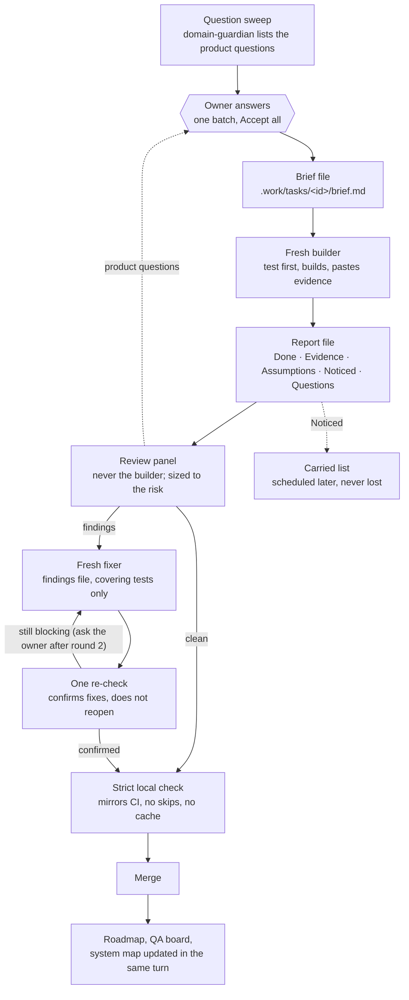

# How the loop works

One person, the **product owner**, decides. One agent, the **controller** (your main Claude Code
session), runs the loop: it writes briefs, sends each task to a fresh agent, reads the reports and
collects questions. It does not build and it does not review. Every other agent does one job and
ends.

## The steps

1. **Question sweep.** Before anything is built, `domain-guardian` reads the task and lists the
   product questions it will raise. They go to the owner as one batch, each with a recommendation.
   The builder starts with the answers. ([`decision-batch`](../plugin/skills/decision-batch/SKILL.md))
2. **Brief.** The controller writes a brief file that a fresh agent can work from alone: goal,
   scope, acceptance criteria, the tests that cover the area, the project's guard tests, the owner's
   answers, the house rules and the report path. ([`write-brief`](../plugin/skills/write-brief/SKILL.md))
3. **Build.** One fresh agent per task. It writes the failing test first, builds, breaks its own
   code once to see the test go red, and pastes the output of what it ran.
4. **Report.** No pasted evidence means not done. The controller reads **Assumptions** first (a
   product choice in there is really a question) and moves **Noticed** to the carried list.
5. **Review.** Reviewers are chosen by what the change touches, run in parallel with separate
   scopes, and get the diff and the rules, never the builder's reasoning.
   ([`review-panel`](../plugin/skills/review-panel/SKILL.md))
6. **Fix.** Findings go to a fresh fixer as one file. The fixer runs only the tests that cover its
   changes. ([`fix-round`](../plugin/skills/fix-round/SKILL.md))
7. **Re-check.** One combined re-check confirms the fixes. It does not reopen the review. After the
   second fix round, the owner decides whether to continue.
8. **Strict local check.** The full suites run once, the way CI runs them.
   ([`local-ci`](../plugin/skills/local-ci/SKILL.md))
9. **Merge and update.** The roadmap, the QA board and the system map change in the same turn.
   ([`progress-boards`](../plugin/skills/progress-boards/SKILL.md), [`system-map`](../plugin/skills/system-map/SKILL.md))

## Around the loop

- **Bigger decisions** with real trade-offs go to the [board](../plugin/skills/board/SKILL.md) before they
  become tasks: independent advisors, the owner asked at four checkpoints, dissent kept visible.
- **Screens** get a [screenshot review](../plugin/skills/design-review/SKILL.md) by the designer before the
  owner sees them, and a [research review](../plugin/skills/research-review/SKILL.md) of the spec before
  they are built.
- **Guard hooks** refuse edits to protected files, pattern kills and skipped git hooks while the loop
  runs ([hooks](../README.md#the-guard-hooks)).

## Why it is shaped like this

| Problem seen                                         | What the loop does about it                                     |
| ---------------------------------------------------- | --------------------------------------------------------------- |
| The builder's reviewer repeats the builder's mistake | The builder never reviews; reviewers never see its reasoning    |
| "Done" with no tests run                             | Evidence pasted, or the report goes back                        |
| Questions found halfway through a build              | A question sweep before the build, one batch to the owner       |
| Fix rounds that never end                            | Fresh fixers, confirm-only re-checks, owner asked after round 2 |
| Long, costly agent sessions                          | One task per fresh agent; files, not conversations              |
| A green check that could not fail                    | Break the code once; run checks the way CI does                 |
| Unasked "improvements" beside the real change        | Change only the task; Noticed goes to a list                    |
